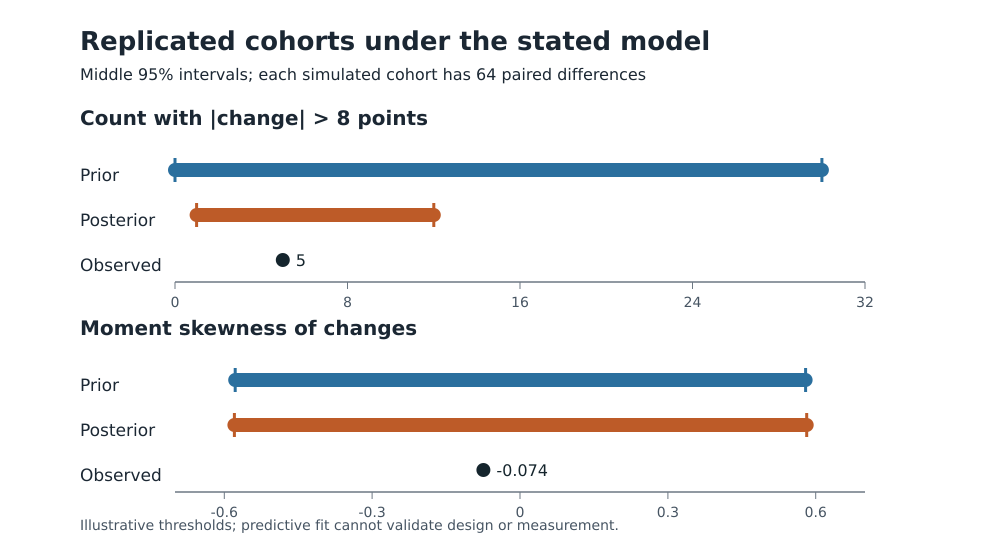
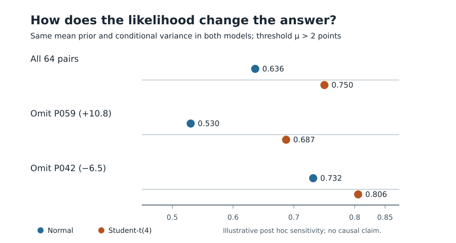

# Unit 4: optional technical audit

This note retains the exact replicated-cohort derivations, joint direct simulation and matched-likelihood sensitivity from the earlier full-length pilot. It is supplementary to the concise Unit 4 of the book, not a second set of reader exercises. Results remain conditional on the declared synthetic data and models. Commands named here run from the resource root. Direct independent draws and deterministic quadrature are not MCMC.

## Bayesian model card

Let `d_i = after_i - before_i` and assume conditionally independent `d_i | mu, v ~ Normal(mu, v)`. Before seeing these synthetic outcomes, choose `v ~ InverseGamma(a0=3, b0=50)`, using density proportional to `v^(-a0-1) exp(-b0/v)`, and `mu | v ~ Normal(m0=0, v/kappa0)` with `kappa0=4`. Thus the prior ties uncertainty in the mean to the unknown variance. It is a mathematical teaching prior with prior predictive plausibility on this invented scale, not a substantive prior learned from real psychology studies. It does not confer construct validity.

The estimand is `mu`, conditional on this likelihood/prior and observed pairing. Set `n=64`, sample mean `dbar=2.1953125`, within-pair sum of squares `S`, and update:

```text
kappa_n = kappa0 + n
m_n = (kappa0*m0 + n*dbar) / kappa_n
a_n = a0 + n/2
b_n = b0 + S/2 + kappa0*n*(dbar-m0)^2/(2*kappa_n)
mu | data ~ Student-t(df=2*a_n, location=m_n,
                      scale=sqrt(b_n/(a_n*kappa_n)))
```

Here `kappa_n=68`, `m_n=2.066176`, `a_n=35`, `b_n=593.536103` and `df=70`. This exact Student-t result is the benchmark against which a later sampler must be checked; there are **no MCMC draws or divergences** in the current analysis. A fixed model can be computed correctly and still fit the data poorly.


### Exact replicated-cohort checks

Instead of treating 64 new differences as independent draws from the *marginal* individual predictive distribution, draw one shared `mu` and `v` from the posterior and then 64 conditional differences. Integrating over these shared parameters gives a Student-t distribution for the replicated cohort **mean** and a scaled F distribution for its unbiased **sample variance**. The analytic intervals below concern *statistics of a new 64-person cohort*, not an interval for `mu` or one new person. The prior columns use the same construction before updating. Run `python3 scripts/analyze_unit04_checks.py` for the exact record; `make verify` and the base-R `scripts/verify_unit04_checks_in_R.R .` recompute it from the unchanged CSV.

| Statistic | Observed | Prior replicated 95% interval | Posterior replicated 95% interval |
| --- | ---: | ---: | ---: |
| Cohort mean change, points | **2.195** | **[-5.148, 5.148]** | **[0.636, 3.497]** |
| Sample variance, squared points | **16.967** | See exact record | **[10.403, 27.471]** |

The observed mean is at posterior predictive cumulative probability **0.571**, and the observed variance at **0.503**. These locations do not signal a conspicuous mismatch on these two statistics; they are not an ordinary p value or proof of normality. The posterior uses the observed data, so this is a model-criticism check with double use of data, not an independent forecast validation.

Five observed changes exceed **8 points in absolute value**. The fitted marginal predictive probability for one new difference to exceed that *illustrative audit cutoff* is **0.087**, yielding an expected **5.595** such changes in 64 new pairs. This is only an expected count: because all replicated differences share drawn parameters, a binomial tail-count interval cannot be inferred by treating the 64 marginal predictions as independent. The eight-point cutoff was selected for this teaching audit and has no validated practical importance. The joint simulation below checks the actual count distribution.

### Joint prior and posterior predictive simulation

For each replicated cohort, draw **one shared** variance `v` and mean `mu` from the prior or exact posterior, then draw 64 conditional normal differences. Repeat this 30,000 times for each distribution. These are independent **direct conjugate** parameter draws followed by replicated data, **not MCMC**; no chain convergence, R-hat, ESS or divergence claim applies. Python uses `scripts/simulate_unit04_joint.py`, and the public Python verification route and `scripts/verify_unit04_joint_in_R.R` audit the numerical and simulation targets. The seed and algorithm family are recorded; Python and R use different random streams, so individual draws are not expected to match. The numerical figures below are Monte Carlo estimates with uncertainty on the order of 0.003 for the quoted probabilities.

| Model check on a 64-person replicated cohort | Observed | Prior predictive | Posterior predictive |
| --- | ---: | ---: | ---: |
| Number of individual changes with `|d|>8` | **5** | Middle 95% of simulated counts **[0,30]** | Middle 95% **[1,12]**; `P(count >= 5)` **0.611** |
| Moment skewness of differences | **-0.074** | Simulated middle 95% roughly **[-0.578,0.579]** | Middle 95% **[-0.579,0.582]**; `P(|skew| >= 0.074)` **0.786** |
| At least one individual change with `|d|>15` | Not a prespecified data summary | **0.278** probability | **0.080** probability |

{width=6.1in}

*Figure 4.2.* Whole-cohort predictive checks under the stated normal model. The count uses an illustrative eight-point cutoff; the points are the observed statistics. The bars describe replicated cohorts, not uncertainty about the mean parameter.

The prior predicts a wider range of tail counts than the fitted model, which is useful for discussing prior plausibility before outcome inspection. The posterior predictive probabilities are *model-dependent discrepancy locations*, **not ordinary p values**. The model was fitted to these same data; central-looking checks do not prove normality, validated attention measurement, independence across people, or an intervention effect. The simulated tail count has wider uncertainty than a binomial calculation using the marginal 0.087 probability because latent parameters are shared. The 15-point cutoff is a classroom plausibility example, not a clinical or educational threshold. The exact replicated mean/variance formulas above also serve as independent controls on these simulation paths.

### Influence of one pair

Recomputing the full exact update after removing each pair moves `P(mu>2 | data, model)` from **0.448** when **P059** (a +10.8-point change) is omitted to **0.653** when **P042** (a -6.5-point change) is omitted, compared with **0.553** in all 64 pairs. An action rule at 0.50 would therefore change under one omission. This is leave-one-out influence on a conditional posterior question, not a reason to delete either fictional participant and not a correction for selection, measurement or likelihood misspecification.

Holding the variance prior fixed while changing the prior's mean concentration changes the meaningful-threshold answer:

| `kappa0` | Interpretation in this model | Posterior location, points | `P(mu>2 | data, model)` |
| ---: | --- | ---: | ---: |
| 0.5 | Broader conditional prior on mean | 2.178 | 0.636 |
| 4 | Primary teaching prior | 2.066 | 0.553 |
| 16 | More skeptical concentration around zero | 1.756 | 0.302 |

This is a *conditional prior sensitivity*, not a claim that all priors are pseudodata or that one value is uniquely correct. It is material for a decision tied to two points. Unknown-variance likelihood, missingness and measurement sensitivity remain open for the completed pilot.

### Likelihood and influential-pair sensitivity

As a **post hoc teaching comparison**, hold the mean prior fixed at `mu ~ Normal(0, 5²)` and compare two likelihoods for the same 64 after-minus-before differences. Model N uses `d_i | mu ~ Normal(mu, 4²)`. Model T uses `d_i | mu ~ Student-t(df=4, location=mu, scale=sqrt(8))`. The Student-t conditional variance is `4/(4-2) × 8 = 16`, the same as the Normal conditional variance. Both scales are fixed *for this sensitivity exercise*; the real population variance is not known. With four degrees of freedom, `mu` remains the model's mean difference. The prior and conditional variance are matched so the contrast changes the likelihood shape. It is not a prospective choice made before seeing this synthetic cohort.

Model N has an exact conjugate Normal posterior. Model T's one-dimensional posterior is integrated numerically over `mu`, with an enlarged integration range check; independent Python composite-Simpson and base-R adaptive integration paths audit the values. Run `python3 scripts/analyze_unit04_likelihood.py` and `Rscript scripts/verify_unit04_likelihood_in_R.R .` from the resource directory. These are deterministic calculations, **not MCMC**; no R-hat, ESS or divergence diagnosis is available or needed for the integration. Figure 4.3 compares the same threshold across the three specified data subsets.

| Data used | Likelihood | Posterior mean, points | 95% credible interval, points | `P(mu>2 | model, data)` |
| --- | --- | ---: | ---: | ---: |
| All 64 pairs | Normal with SD 4 | **2.174** | **[1.198, 3.149]** | **0.636** |
| All 64 pairs | Student-t(4), scale `sqrt(8)` | **2.311** | **[1.401, 3.214]** | **0.750** |
| Omit P059 (+10.8) | Normal | **2.038** | **[1.055, 3.021]** | **0.530** |
| Omit P059 (+10.8) | Student-t(4) | **2.224** | **[1.314, 3.126]** | **0.687** |
| Omit P042 (-6.5) | Normal | **2.310** | **[1.327, 3.293]** | **0.732** |
| Omit P042 (-6.5) | Student-t(4) | **2.396** | **[1.490, 3.296]** | **0.806** |

{width=6.1in}

*Figure 4.3.* Conditional model sensitivity to likelihood shape and two influential pairs. Omission is a diagnostic calculation, not a proposal to discard either fictional record.

The original normal–inverse-gamma analysis above gives **0.553**, but it estimates an unknown variance and uses a mean prior conditional on that variance. Comparing 0.553 with either value in this table changes more than the likelihood; only the two *matched* rows within each data subset isolate likelihood shape under the stated fixed-dispersion assumptions. The Student-t likelihood reduces the change from omitting P059 from about **0.106** to **0.063** in `P(mu>2)`, yet the threshold answer still depends on modeling and on which pairs are included. These conditional probabilities are **not a Bayes factor**, posterior probabilities of the two models, a validation of normality, or evidence that reflection practice caused the change. A prespecified application would also examine plausible scale and degrees-of-freedom choices, measurement error and missing pairs.

